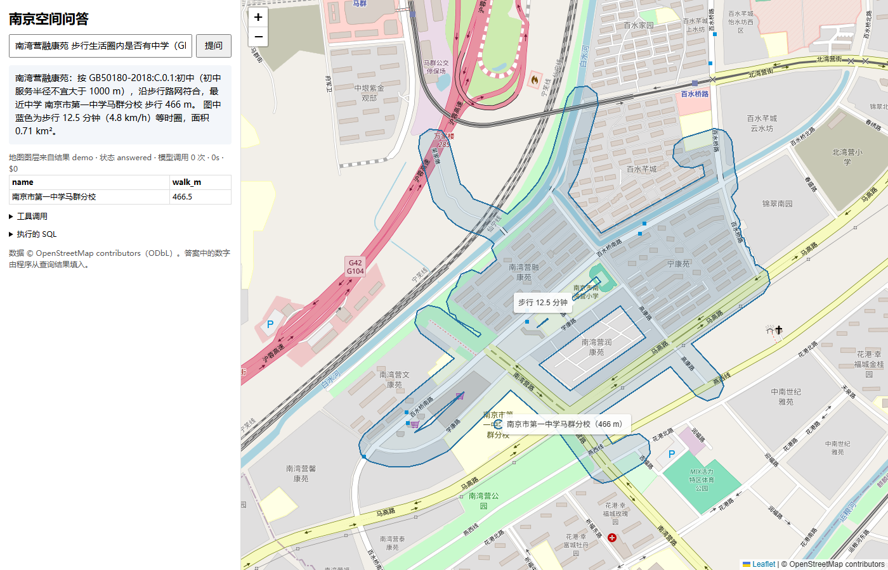
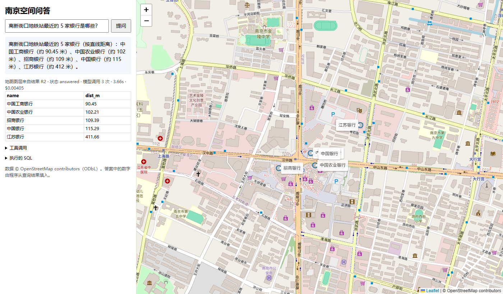

# geo-agent：南京 OSM + PostGIS / pgRouting / pgvector 空间问答 Agent（两轮预注册评测）

[](https://github.com/PlainSightX/geo-agent/actions/workflows/ci.yml)

[](LICENSE)


用中文提问城市空间问题，系统把问题交给 LangGraph Agent：它调用类型化 GIS 工具（缓冲区、最近邻、按区统计、面积/长度、拓扑关系）、
**步行路网工具**（pgRouting 最短路、等时圈、N 分钟可达设施）、**规划标准条文检索**（GB 50180-2018 摘录 + 本地向量模型 + pgvector）
或受限的只读 SQL，由确定性校验器检查单位/CRS、空结果、截断与条文引用，最多修复 3 次，最后输出一段**数字全部由程序从查询结果中填入**的中文答案和 GeoJSON。
项目的重点是评测：两轮都是先写题和金标并冻结哈希，再让同一模型（`deepseek-chat`）以“单次 text-to-SQL”和“Agent”两种方式作答，用确定性规则判分。

- **第一轮**（61 题、详细中文 schema 注释）：两者没有可分辨差异，Agent 57/61 vs 基线 56/61，McNemar p = 1.0。
- **第二轮**（72 题、精简 schema、原始 OSM 标签/别名/投影陷阱/步行路网/标准合规，各臂 3 次）：
  Agent **68/72 = 94.4%** [86.6, 97.8] vs 单次 text-to-SQL **51/72 = 70.8%** [59.5, 80.1]（run1），配对 McNemar **p = 0.0005**；
  3 次均值 94.0% vs 72.7%。差距几乎全部来自路网与合规题；在原始标签题上 Agent 反而更差（75% vs 97%）。代价约 8.4 倍费用、2.8 倍延迟。
- **本地 Qwen3-8B**（vLLM，同一题集与系统，只换模型，各臂 3 次）：Agent **19.9%** [15.1, 25.7]，低于它自己的单次 SQL（36.1%）和 DeepSeek Agent（94.0%），
  run1 配对 54 vs 0（p ≈ 1e-16）。主要失败是工具调用写成纯文本、名称解析循环和计数方式误用，不能直接替换。
- **Qwen3-8B LoRA 微调**（1,342 条程序化金标轨迹，1.5 GPU 小时，预注册判定）：新冻结的 150 题 heldout 上 **130/150 = 86.7%** vs 基座 59/150（p = 1.5e-19）；
  r2 72 题 **51/72 = 70.8%** vs 基座 15/72（p = 5.6e-9），仍低于 DeepSeek Agent 68/72（19 vs 2，p = 0.0002）。按预注册规则判定为“微调有效”。
- **MCP 服务器**（`geo-agent-mcp`，官方 Python SDK，stdio 为主）：把第二轮 15 个已测试的空间工具、精简 schema 与条文清单暴露给 Claude Desktop、Cursor 等 MCP 客户端，只读、同一 SQL 守卫与限额，见下文“MCP 服务器”。



# 第一轮（2026-10-18，tag `round1`）



## 关键结果（test1，2026-10-18，`deepseek-chat`，temperature 0，各臂各跑一次）

| 指标 | (a) 单次 text-to-SQL | (b) Agent（工具 + 校验 + 修复） |
|---|---|---|
| **总体正确率（61 题）** | **56/61 = 91.8%** [82.2, 96.5] | **57/61 = 93.4%** [84.3, 97.4] |
| 可回答题执行准确率（52） | 47/52 = 90.4% [79.4, 95.8] | 48/52 = 92.3% [81.8, 97.0] |
| 不可回答题拒答正确（9） | 9/9 [70.1, 100] | 9/9 [70.1, 100] |
| 有效 SQL 率（模型写的原始 SQL） | 49/49 = 100% | 29/32 = 90.6%（3 条均在下一步修复） |
| 单位/CRS 错误（33 道度量题） | 0/33 [0, 10.4] | 1/33 [0.5, 15.3] |
| 模型调用 / 题 | 1.00 | 2.30 |
| 费用 / 题（估算） | $0.0004 | $0.0030 |
| 延迟中位数 / p90 | 0.98 s / 1.18 s | 2.20 s / 3.48 s |

方括号为 Wilson 95% 区间。配对：两臂都对 53 题、都错 1 题，仅基线对 3 题、仅 Agent 对 4 题，精确 McNemar p = 1.0。
全部 API 花费（含开发调试、测试集、演示）约 **$0.31**（台账：`eval/runs/ledger.jsonl`）。

**怎么理解**：给定带中文注释的 schema 时，同一个模型单次写 SQL 已经能答对九成以上；这组题区分不出 Agent 的优势。
Agent 在本项目里的实际价值是工程性质的：答案数字可追溯到具体查询、结果能直接上图、写错 SQL 能自我修复、模型手写的数字会被拦截。
这些在下面的失败案例里都有体现，但它们没有转化成这 61 题上的准确率提升。

## 快速开始

需要 Docker、[uv](https://docs.astral.sh/uv/)、Git Bash（Windows）或任意 bash。

```bash
uv sync --locked
bash scripts/load_data.sh          # 下载固定日期的 OSM 快照（约 80 MB，校验 sha256）→ GDAL 容器导入 → 建表，约 1 分钟
uv run pytest -q                   # 87 个测试；没有数据库时自动跳过 13 个集成测试，不需要 API key

# 需要 DEEPSEEK_API_KEY：
uv run uvicorn geo_agent.api:app --host 127.0.0.1 --port 8765
# 浏览器打开 http://127.0.0.1:8765/?q=离新街口地铁站最近的 5 家银行是哪些？

# 复现评测（判分不需要 API；运行两臂约 $0.21）
uv run python eval/freeze_gold.py --check          # 重新执行金标 SQL 并做边界裕度检查
uv run python eval/run_eval.py --arm baseline --set test --run myrun
uv run python eval/run_eval.py --arm agent    --set test --run myrun
uv run python eval/score.py --run myrun
```

## 架构

```
问题 ──► LangGraph:  model ──tool_calls──► tools ──► model … ──final_answer──► 绑定答案 + GeoJSON
                       │                     │
                       │       ┌─────────────┴──────────────────────────────┐
                       │       │ 类型化工具 (tools.py，参数化 SQL，geography 米制) │
                       │       │  find_entity / distinct_values（自省）        │
                       │       │  within_distance / nearest_k / count_by_district │
                       │       │  measure / spatial_relation / distance_between │
                       │       │ run_sql：sqlglot AST 白名单 → 单位静态检查 → 执行 │
                       │       └─────────────┬──────────────────────────────┘
                       │                     ▼
                       │       校验器：守卫拒绝 / 执行错误 / 单位·CRS / 空结果 / 截断
                       │       有问题 → 回传给模型并消耗 1 次修复额度（≤3）
                       ▼
               deepseek-chat（每次调用写入费用台账，累计 $3.6 停止）

PostGIS 16-3.5（docker compose，镜像固定 digest）
  geo_reader 角色：只读、无 CREATE、statement_timeout 5s；每次查询再包一层 READ ONLY 事务；最多返回 200 行
```

三层只读防线：sqlglot 语法树白名单（只允许单条 SELECT/UNION/CTE，禁止 INTO/FOR UPDATE/DML/DDL/COPY/SET，表名限业务表，未识别函数只放行 `st_*` 与少量白名单）
→ 只读事务 + 语句超时 → 数据库角色权限。测试覆盖了“绕过守卫直接执行 CREATE TABLE 也会失败”。

**单位/CRS 检查**（`units.py`）：所有几何都是 EPSG:4326（度）。对 `ST_Distance/ST_DWithin/ST_Area/ST_Length/ST_Buffer` 的几何参数要求转 `geography` 或 `ST_Transform` 到米制 CRS（32650 / 4547 / 4549）；
3857 Web 墨卡托在南京纬度长度放大约 18%，视为错误。在执行前拦截，比“跑出一个看似合理的错数字”更早暴露问题。

**数字绑定**（`answer.py`）：模型只能写 `{R3.n}`、`{R3.count}`、`{R3.rows[0].name}`、`{R3.rows}` 这类占位符；
问题原文以外的裸数字一律剔除并记录。最终被判分、被上图的结果，就是答案引用的那次工具结果（可用 `result_rows` 选行、`result_as=count` 让程序计数）。

## 数据

- 来源：Geofabrik 江苏省 OSM 快照 `jiangsu-261017.osm.pbf`（2026-10-17），sha256 `dcba9384…2652e`，md5 与 Geofabrik 发布值一致。见 `data/SOURCE.json`。
- 处理：GDAL 3.10.3 容器按外包框读取 → `sql/build_tables.sql` 按南京市行政边界（OSM relation 2131524）精确裁剪、修复无效几何。原始 PBF 不入库。
- 表：`districts` 11、`pois` 9,088、`metro_stations` 272（换乘站按站名合并）、`roads` 32,153、`waterways` 1,976、`water_areas` 5,727、`parks` 495。
- 11 个区边界拓扑干净：22 对相邻区 `ST_Touches` 为真、交叠面积为 0；面积合计约 6,591 km²（官方 6,587 km²）。
- 许可：© OpenStreetMap contributors，[ODbL 1.0](https://www.openstreetmap.org/copyright)。代码为 MIT；由 OSM 派生的数据库若公开分发，须按 ODbL 提供。

## 评测设计（预注册）

完整预注册见 `eval/PREREGISTRATION.md`。要点：

- **先冻结、后建模**：题目、金标 SQL、执行结果与哈希在提交 `ac3c09c` 中冻结，早于 Agent 代码（`ba0d532`）和任何模型调用。
- **61 题 7 层**：属性过滤 8、距离/缓冲 9、最近邻 8、按区空间连接/聚合 10、多步 9、CRS/单位陷阱 8、数据无法回答 9。另有 10 题开发集（与测试集不重叠）用于调试。
- **边界裕度检查**：冻结前自动检查——半径/阈值题中所有候选对象与阈值相差 ≥ 0.5%，top-k 题第 k 与 k+1 名相差 ≥ 0.5%，避免“合理的不同算法”翻转金标。
  这个检查在冻结前抓到 4 道有歧义的题（如 B08：4 家咖啡馆距新街口 997.8–1004.0 米，正好跨 1 km），改了半径或 k 后才冻结。
- **确定性判分**（`matcher.py`）：预测可多出列；金标每列须单射映射到预测列；行按多重集合比较（D06 要求顺序）；数值相对误差 ≤ 0.5%。不用 LLM 打分。
- **统计**：Wilson 95% 区间；配对精确 McNemar。

## 失败案例（全部保留）

逐题记录在 `eval/runs/test1/per_question.json`，原始轨迹在 `eval/runs/test1/*.jsonl`。

**基线（5 题错）**

- B03 “江苏省人民医院 2 公里内的其他医院”：用 `name <> '江苏省人民医院'` 排除自身，把同名的另一条记录也排除了（9 vs 金标 10）。
- C05、E07、F06：模型输出 JSON 后又追加了“Wait, that returns multiple rows…”之类的自我纠正文字，解析失败。这是单次调用协议的真实失败模式，按预注册判错。
- E06 “鼓楼区道路总长度”：用 `ST_Within` 只算完全在区内的路段（361.7 vs 407.5 km）。

**Agent（4 题错）**

- A05 “菜系标注为 noodle”：写成 `ILIKE '%noodle%'`，多算了 `noodle;chinese` 等多值标签（33 vs 28）。口径之争，也可以认为 33 更合理。
- A08 “名称以南京开头的博物馆”：查询完全正确，但模型反复改写同一查询 7 次，始终没有调用 `final_answer`，步数用尽。这是循环控制失败。
- E06：用 `ST_Intersects` 但没有按区界裁剪（467.3 vs 407.5 km）。两臂都错的唯一一题。
- F02 “玄武湖面积多少公顷”：`measure` 只给平方公里，模型在模板里手写“349.7 公顷”，被绑定器剔除；引用的结果没有公顷列，判错并计为单位错误。绑定器起了作用，但工具缺一个单位选项。

**其他瑕疵**：Agent 有 5 个答案文本含 `?` 或 `□`（无效占位符如 `{R1.row_count}`，或被剔除的手写数字），其中 3 题最终结果仍判对。答案文本质量不在预注册指标里。

## 预注册之后的改动（披露）

1. **单位错误的数量级判定**：首版对“同时返回 m 和 km 两列、且已判对”的 F04 误报。修订为只在判错题上、金标数值在预测中无相等值但恰好差 10^k 时才计。Agent 单位错误 2→1，正确率不变。
2. **基线原始输出日志被截断为 300 字符**，C05、E07 无法事后复核。已修复，test1 不重跑。
3. **事后敏感性分析**（`eval/sensitivity.py`，`runs/test1/sensitivity.json`）：基线解析器放宽为只取第一个 JSON 对象后，F06 仍错；C05、E07 若全算对（上界），基线为 58/61 = 95.1%，McNemar p 仍为 1.0。结论不变。
4. 演示页在最终结果无几何列时改为渲染最近一个带几何的工具结果（只影响地图，不影响评测）。

## 局限

- **样本量小**：单臂区间宽约 ±7 个百分点；两臂只有 7 题不一致，只能检测很大的差异。
- **题目和金标由作者一人编写**，代表一种口径（区内 = ST_Within、道路按区界裁剪、实体按名称识别）；B03、A05、E06 的失败都与口径有关。
- **schema 注释很详细**（中文类别映射、单位提示），这本身帮助了基线；在注释更少、表更多的真实库上结果可能不同，本项目没有测。
- 单一模型、单一城市、单一快照、temperature 0 单次运行，没有测重复运行方差。开发集偏简单（两臂都 10/10），Agent 提示与工具在开发集上调过 3 轮。
- 没有路网，不支持路径/通行时间；“route”类问题归入不可回答。没有空间 RAG（文档检索）部分。
- OSM 在中国数据不完整（很多酒店无名称），数量结论只针对该快照，不代表真实世界。
- 演示 API **没有鉴权**，只应监听 127.0.0.1；每次请求都会消耗 API 额度，公网部署前必须加鉴权与限流。
- 费用按 $0.30 / $1.20 每百万 token 统一估算，未计缓存折扣，实际账单更低。


# 第二轮（2026-10-18）：路网、标准检索与更难的预注册题集

第一轮的结论是“题太容易、schema 注释太详细”。第二轮按 GIS + AI 岗位常见要求（路径规划、空间 RAG、空间 SQL、GeoJSON）扩展系统，
并换一组更接近真实使用的题。第一轮的全部文件、结果与 `round1` 标签保持不变，第一轮 52 道可回答题的金标哈希在新镜像上逐题复现。

## 第二轮结果（`deepseek-chat`，temperature 0，每臂 3 次）

| 指标 | (a) 单次 text-to-SQL | (b) Agent（全部工具） | (c) 消融：去掉路网/检索/合规工具 |
|---|---|---|---|
| **run1 正确率（72 题）** | **51/72 = 70.8%** [59.5, 80.1] | **68/72 = 94.4%** [86.6, 97.8] | 62/72 = 86.1% [76.3, 92.3] |
| 3 次逐次 | 70.8% / 75.0% / 72.2% | 94.4% / 93.1% / 94.4% | 86.1% / 86.1% / 88.9% |
| 3 次合并 | 157/216 = 72.7% [66.4, 78.2] | 203/216 = 94.0% [90.0, 96.5] | 188/216 = 87.0% [81.9, 90.9] |
| 题级 3 次一致率 | 81.9% | 97.2% | 79.2% |
| 模型调用 / 题 | 1.00 | 3.01 | 3.33 |
| 费用 / 题（估算） | $0.0008 | $0.0065 | $0.0061 |
| 延迟中位数 / p90（run1） | 1.3 s / 2.4 s | 3.6 s / 5.6 s | 3.9 s / 7.3 s |
| 模型原始 SQL 有效率（run1） | 52/61 = 85.2% | 64/75 = 85.3%（失败均在后续修复） | 135/142 = 95.1% |

**按层（3 次合并，括号为 Wilson 95% 区间）**

| 层（题数） | (a) 基线 | (b) Agent | (c) 消融 |
|---|---|---|---|
| tag 原始标签语义（12） | **97.2%** [85.8, 99.5] | 75.0% [58.9, 86.2] | 77.8% [61.9, 88.3] |
| join 多表/别名（12） | 77.8% [61.9, 88.3] | 100% [90.4, 100] | 100% [90.4, 100] |
| crs 投影与度量（10） | 73.3% [55.6, 85.8] | 93.3% [78.7, 98.2] | 90.0% [74.4, 96.5] |
| route 路网（16） | **35.4%** [23.4, 49.6] | **95.8%** [86.0, 98.8] | 91.7% [80.4, 96.7] |
| compliance 标准合规（12） | 69.4% [53.1, 82.0] | **100%** [90.4, 100] | 63.9% [47.6, 77.5] |
| unanswerable 不可回答（10） | 100% | 100% | 100% |

**配对（run1，精确 McNemar）**：基线 vs Agent：仅基线对 3 题（T06、T07、T10），仅 Agent 对 20 题，p = 0.0005。
消融 vs Agent：仅消融对 1 题，仅 Agent 对 7 题（6 道是合规/可达计数），p = 0.070。基线 vs 消融：8 vs 19，p = 0.052。

第二轮全部 API 花费（开发集 + 9 次测试运行）约 **$3.07**；项目累计 $3.38（台账 `eval/runs/ledger.jsonl`，模型字段全部为 `deepseek-flash`，即 `deepseek-chat`）。

**怎么理解**

- 在路网题上，单次 SQL 的失败不是“不会”，而是一次写对一条 60–100 行的 pgRouting 查询很难：最常见的错误是
  `MIN(agg_cost)` 取到路径第一行的 0（12 次）、`round(double precision, int)` 类型错误（6 次）、把 32650 投影几何转 geography（6 次）、超时（3 次）。
  Agent 的 `walk_route/isochrone/reachable` 把这些口径固化在参数化查询里，模型只填起终点。
- 消融臂说明工具化本身就有价值：同样能写 pgRouting SQL、同样有修复循环，只去掉 5 个工具，路网题仍有 91.7%（修复循环救回了大部分 SQL 错误），
  但**合规题从 100% 掉到 63.9%**——13 次失败中 11 次是结论对了但结果里没有条文 id、2 次步数用尽未作答；`check_compliance` 由程序读取条文半径、强制输出 clause_id，正是它补上的部分。
- 原始标签题上 Agent 更差，原因是它**更主动地探索**：用 `tag_values` 看到 `brand=KFC`、`takeaway=only`、`蔚来换电站` 后把它们也算进去，
  口径比金标宽（83 vs 81、165 vs 164、13 vs 12）。按预注册判错；事后敏感性分析（非预注册，`eval/r2/sensitivity.py`）把这三个更宽口径也算对时，
  Agent run1 为 71/72，基线 51/72，结论不变。这暴露的是题面歧义（“品牌标签为肯德基”是否包含英文品牌值），不是 Agent 的推理错误。
- 不可回答题两臂都是 10/10，第二轮没有区分度；开发集与测试集上都没有出现编造数字的回答。

## 第二轮新增的架构

```
问题 ──► LangGraph（同第一轮：model ⇄ tools，校验 + ≤3 次修复 + 数字绑定；第二轮最多 10 次模型调用）
           │
           ├─ 自省：find_entity（名称 + alt_name/old_name/short_name/name:en 别名）· distinct_values · tag_values（原始 OSM 标签）
           ├─ 直线 GIS：第一轮 6 个工具
           ├─ 路网（pgRouting 3.8）：walk_route（pgr_dijkstra）· isochrone（pgr_drivingDistance + 边缓冲）· reachable（N 分钟可达设施）
           ├─ 标准（RAG）：retrieve_standard（bge-small-zh ONNX 本地向量 → pgvector 余弦 top-k）· check_compliance（半径由程序从条文读取）
           └─ run_sql：sqlglot 守卫（pgRouting 函数的“边查询”字符串参数递归过同一白名单）→ 单位静态检查 → 只读事务
           │
           ▼  校验器新增：合规结果引用的 clause_id 必须存在；若含 radius_m，必须等于条文数值
       绑定答案 + GeoJSON（线 / 面 / 点）
```

- **数据库镜像**：`pgrouting/pgrouting:16-3.5-3.8.0`（digest 固定）+ pgvector 0.8.6（deb sha256 固定，`docker/db.Dockerfile`）。
  选它是因为 PostgreSQL 16.9 / PostGIS 3.5.2 与第一轮完全相同，可直接复用数据卷。
- **步行路网**（`sql/build_walk_network.sql`）：从同一 OSM 快照的线要素构建，纳入 primary…residential、service、pedestrian、footway、path、steps、track、cycleway；
  trunk 只在 `foot=yes|designated|permissive` 时纳入，motorway 一律排除；排除 `foot=no` 与未允许步行的 `access=private|no`。只在 OSM 共享节点与端点处打断（桥隧不与下方道路相交）。
  结果：**118,304 条边、87,970 个顶点、21,204 km；1,088 个连通分量，最大分量占顶点 94.4%、长度 97.3%**。全部路由在最大分量上进行。
- **口径**：步速 4.8 km/h = 80 m/min；要素代表点（面取 `ST_PointOnSurface`，同名取 id 最小）吸附到最大分量的 KNN 最近顶点，吸附段不计入；
  等时圈 = 两端可达的边在 EPSG:32650 上 2 m 简化、50 m 缓冲后求并（比先并后缓冲快约 16 倍，面积差 < 1%），是“边缓冲”而不是凹包。
- **条文语料**（`data/standards/`）：住建部官网公开的 GB 50180-2018 全文 PDF（与教育部转载附件逐字节一致，sha256 `78c0b54c…`）是扫描图像、无文字层，
  因此对照页面图像**人工转录**了 31 条摘录（术语 2.0.2–2.0.5、表 3.0.4、5.0.1、附录 B/C 中与 OSM 可映射设施有关的服务半径与配建要求），每条带页码与来源 URL。
  只摘录所需条文、注明出处，不是全文复制；版权与“宜/不宜”属于推荐性要求的说明见 `data/standards/SOURCE.md`。
- **向量模型**：`BAAI/bge-small-zh-v1.5` 的 ONNX 导出（Hugging Face `Xenova/bge-small-zh-v1.5` 修订 `75c43b06`，文件 sha256 固定），
  onnxruntime + tokenizers 在 CPU 上运行，不依赖 torch、不走 API；CLS 池化 + L2 归一化，查询侧加官方检索指令。31 条语料上，测试里的典型查询 top-1 命中目标条文。
- **精简 schema**（`src/geo_agent/r2_schema.py`）：两臂看到同一份——表/列名、类型、行数、几何类型与 SRID、简短英文字段含义；
  **去掉**第一轮那样的“中文概念 = OSM 标签值”映射和写法提示。另给两臂同一份函数说明（pgRouting 签名、边查询写法、吸附方式、pgvector 运算符）和同一份项目口径，
  也就是一个称职的提示工程师会写给模型的内容；基线缺的只是工具、检索与修复，不是信息。
- **演示**：`/?demo=小区名` 不调用模型，直接渲染等时圈、圈内中学与合规判定（上图）；`/?q=...&agent=round2` 用第二轮 Agent 作答。

## 第二轮评测设计（预注册）

完整内容见 `eval/r2/PREREGISTRATION.md`。题目、金标 SQL、金标结果与判分代码在提交 `08309f2` 中冻结（questions sha256 `857a5193…`），
早于第二轮提示词与 Agent 代码（`688e614`）和任何第二轮模型调用。

- **72 题 6 层**：原始标签 12、多表/别名 12、投影与度量 10、路网 16（最短路 8、等时圈 2、可达设施 6）、标准合规 12（6 符合 / 6 不符合）、不可回答 10。
  题面不提示表名、列名、标签键或函数名；路网题写明步速、合规题不给半径数值。
- **金标**由作者的 SQL 计算（`eval/r2/gold_sql.py` 与 `routing.py` 同一口径，集成测试检查两者对同一输入数值一致）。
- **冻结前检查**：直线阈值题候选与阈值相差 ≥ 0.5%；路网/合规题候选设施网络距离与阈值相差 ≥ 1%；top-k 相邻名次差 ≥ 0.5%；结果非空、计数非 0。
  检查改动了 5 道题（J05 半径 100→120 m；D12/D13/D16 原选点结果为 0；J08 去掉品牌为麦当劳的“自助点餐机”）。
- **判分**（`src/geo_agent/matcher_r2.py`）：沿用第一轮结果集比对；路网层数值容差 2%（其余 0.5%）；合规题要求布尔结论与条文 id 都对，若给出 radius_m 必须等于条文值。
- 开发集 12 题（`eval/r2/dev_questions.json`，实体与测试集不重叠）只跑过一次：基线 8/12、Agent 12/12、消融 10/12。

## 第二轮失败案例

逐题记录在 `eval/runs/r2run{1,2,3}/r2_per_question.json`，原始轨迹在同目录 `*.jsonl`。

**Agent（run1 错 4 题；3 次共错 13 题次）**

- T06 / T07 / T10（3 次全错）：口径比金标宽，见上文“怎么理解”。
- D15 “明都雅苑步行 15 分钟内最近的地铁站”（run1 错，run2、run3 对）：`reachable` 给出“市中医院 265 m”，模型怀疑结果，改写 SQL 用 60/150 m 的错误吸附半径自行计算，
  最后引用了“应天东街 999 m”。工具给了对的答案，模型没有信它。
- C03 “Web 墨卡托面积与放大倍数”（run1 对；run2、run3 拒答）：单位校验器把 `ST_Transform(geom, 3857)` 上的面积量算判为错误，模型据此拒答。
  这是**校验器与题意冲突**：题目本身就是要演示 3857 的放大误差。校验器把 3857 一律视为错误的设计在第一轮是合理的，这里过于严格。

**基线（run1 错 21 题）**：路网 11、合规 4、多表/别名 3、投影 3。除上面的 SQL 错误外，典型例子：
J01 “南京炮院”看到 schema 里有 poi_tags 却认为“没有别名标签”而拒答；J08 把品牌为麦当劳的“自助点餐机”算进最近 3 家；
C07 对多边形用 `ST_Length` 求周长得到 0；E08 合规判定把吸附写成“任意 150 m 内的顶点”导致结论错。

**消融（run1 错 10 题）**：合规 4（E03、E06 结论对但缺条文 id，E02、E11 步数用尽未作答）、可达计数 2（D12 得 9 vs 金标 8、D13 得 1 vs 金标 4，自写 SQL 的设施吸附方式与口径不一致）、
C03 用纬度余弦近似放大倍数（1.393 vs 精确 1.397）、T06/T07/T10。

## 第二轮预注册之后的改动（披露）

1. **单位静态检查补漏**（开发集阶段，测试集运行前）：`ST_Buffer(ST_Simplify(ST_Transform(g, 32650), 2), 50)` 被误判为“度坐标上缓冲”，
   因为 `st_simplify` 不在“保持单位”的函数列表里；补上 `st_simplify / st_simplifypreservetopology / st_snaptogrid / st_linemerge`。
   第一轮两臂 100 条最终 SQL 重新判分，正确与单位错误判定均不变。
2. **事后敏感性分析**（`eval/r2/sensitivity.py` → `eval/runs/r2_sensitivity.json`）：只针对 T06/T07/T10 的更宽口径，主结果不变。
3. 演示 API 新增 `agent=round2` 参数与 `/demo/life-circle`（只影响演示，不影响评测）；第一轮默认行为不变。

## 第二轮局限

- **题目、金标、口径都由作者一人决定**。“中学”按名称含“中学”识别（OSM 不区分学段，名称不含“中学”的初中会漏掉）；“小区”= OSM 有名称的 landuse=residential 面；
  设施只按 OSM 标签。这些都是可辩论的口径，失败案例逐题列出。
- “合规”只是按标准**推荐性**服务半径（“不宜大于”）做的空间核查，不是规划审批意义上的合规结论；条文为人工转录，以官方 PDF 为准。
- OSM 步行网络在中国不完整：缺人行道、过街设施和小区内部道路；部分小区代表点到路网吸附超过 100 m，部分干道因 `foot=no` 不可步行，导致网络距离偏长（如新街口→大行宫 2,031 m，直线 1,014 m）。
  结论只针对该快照与该路网，不代表真实步行时间。
- 72 题仍是小样本（单臂区间约 ±10 个百分点）；单一模型、单一城市；temperature 0 仍有逐次差异（基线题级一致率 82%），所以报告了 3 次。
- 第二轮 Agent 的提示词与工具在 12 道开发题上只运行过一次、没有据此调参，但作者在设计工具时知道题型分布（工具口径与金标口径一致是有意为之，基线也拿到了同样的口径文字）。
  这意味着结果衡量的是“把领域口径固化成工具”的价值，而不是 Agent 在陌生任务上的泛化能力。
- 不可回答题两臂都满分，第二轮没有测出拒答能力的差异。

# 本地 Qwen3-8B（私有化部署评估）

问题：在内网或私有化部署时，用本地 8B 模型替换 DeepSeek，这套 Agent 还能用吗？
做法：同一 72 题冻结集（金标冻结于 `08309f2`，未改动）、同一提示词、工具、校验器和判分代码，只把模型换成 vLLM 0.11.2 部署的
**Qwen3-8B 基座**（不加 adapter，bf16，单卡 RTX PRO 6000 96 GB，`--tool-call-parser hermes`，`--max-model-len 32768`）。
温度 0，非思考模式（`enable_thinking=false`，与 DeepSeek 臂一致），三臂各跑 3 次（2026-10-18）。另跑了一次思考模式，单独报告。

**结论：不能直接替换。** Qwen3-8B 的 Agent 比它自己的单次 SQL 还差，比 DeepSeek Agent 低约 74 个百分点。
差距主要来自工具调用协议和多步控制，GIS 知识不是主因。

## 结果（72 题，3 次合并；方括号为 Wilson 95% 区间）

| 指标 | DeepSeek (b) Agent | Qwen3-8B (a) 基线 | Qwen3-8B (b) Agent | Qwen3-8B (c) 消融 |
|---|---|---|---|---|
| **run1 正确率** | **68/72 = 94.4%** [86.6, 97.8] | 25/72 = 34.7% [24.8, 46.2] | **14/72 = 19.4%** [12.0, 30.0] | 13/72 = 18.1% [10.9, 28.5] |
| 3 次逐次 | 94.4 / 93.1 / 94.4% | 34.7 / 36.1 / 37.5% | 19.4 / 19.4 / 20.8% | 18.1 / 16.7 / 16.7% |
| 3 次合并 | 203/216 = 94.0% [90.0, 96.4] | 78/216 = 36.1% [30.0, 42.7] | 43/216 = 19.9% [15.1, 25.7] | 37/216 = 17.1% [12.7, 22.7] |
| 题级一致率（3 次） | — | 97.2% | 98.6% | 95.8% |
| no_answer（216 题次） | 0 | 0 | **89** | 70 |
| 拒答（含不可回答题 30） | 32 | 33 | 44 | 44 |
| 模型调用 / 题 | 3.01 | 1.00 | 6.78 | 6.65 |
| 修复次数 / 题 | 0.16 | — | 1.04 | 1.29 |
| 工具参数校验错误 / 题 | 0.01 | — | 0.50 | 0.78 |
| prompt / completion token / 题 | 20.2k / 389 | 2.0k / 143 | 45.2k / 306 | 34.7k / 321 |
| 延迟中位数 / p90 | 3.1 s / 5.6 s | 1.1 s / 4.4 s | 9.6 s / 15.0 s | 7.5 s / 12.7 s |

DeepSeek 基线与消融见上文第二轮结果（72.7%、87.0%）。Qwen 的延迟是 3 次运行同时进行、每次 4 线程（最多 12 个并发请求）共用一张卡时测得的，单请求延迟会更低。
三臂 9 次运行共约 3,100 次模型调用、约 1,700 万 prompt token，墙钟时间约 6 分钟；本地端点不计费，台账在 `eval/runs/local/ledger_local.jsonl`。

**按层（3 次合并正确率）**

| 层（题数 × 3） | DeepSeek Agent | Qwen 基线 | Qwen Agent | Qwen 消融 |
|---|---|---|---|---|
| tag 原始标签（36） | 75.0% | 36.1% | 25.0% | 16.7% |
| join 多表/别名（36） | 100% | 38.9% | 8.3% | 27.8% |
| crs 投影与度量（30） | 93.3% | **70.0%** | 10.0% | 3.3% |
| route 路网（48） | 95.8% | 0% | 20.8% | 6.2% |
| compliance 合规（36） | 100% | 0% | **0%** | 0% |
| unanswerable 不可回答（30） | 100% | 100% | 60.0% | 56.7% |

**配对（run1，精确 McNemar）**

- DeepSeek Agent vs Qwen Agent：仅 DeepSeek 对 54 题，仅 Qwen 对 0 题，**p ≈ 1×10⁻¹⁶**（3 次多数票配对：53 vs 0）。
- Qwen 基线 vs Qwen Agent：仅基线对 18 题，仅 Agent 对 7 题，**p = 0.043**，方向与 DeepSeek 相反（DeepSeek 上 Agent 显著更好）。
  仅基线对的 18 题：投影/度量 7、别名/多表 4、不可回答 4（Agent 硬答）、标签 3；仅 Agent 对的 7 题：最短路 3、标签 2、度量 1、别名 1。
- Qwen 消融 vs Qwen Agent：6 vs 7，p = 1.0。工具化在 8B 上没有带来可测的收益。
- DeepSeek 基线 vs Qwen 基线：28 vs 2，p = 9×10⁻⁷。

**思考模式**（`--thinking`，各 1 次，不与上表合并）：基线 21/72 = 29.2% [19.9, 40.5]，Agent 13/72 = 18.1% [10.9, 28.5]，
与非思考模式相比都没有显著差异（基线 4 vs 0，p = 0.125；Agent 8 vs 7，p = 1.0）。Agent 延迟中位数升到 26.8 s，completion token 增加约 7 倍。
思考模式基线拒答 41 题（非思考 11 题），常见理由是“数据库中没有营业时间数据”，而这些信息在 `poi_tags` 里。

## Qwen Agent 在哪里失败

事后分类（非预注册，规则见 `eval/local_llm/failure_taxonomy.py`，每个错题次只计一个主因；结果 `eval/runs/local/failure_taxonomy.json`）。
Agent 臂 3 次共错 173 题次：

| 主因 | 题次 | 说明 |
|---|---|---|
| 工具调用写成纯文本 | 48 | 拿到工具结果后输出 `final_answer\n{"result_ref": "R1", …}` 或裸 JSON，不带 `<tool_call>` 标签，vLLM 的 hermes 解析器返回 `tool_calls=None`；循环提醒“请调用 final_answer”后模型重复同一段文本，直到 10 次调用用尽 |
| 调用次数用尽 | 36 | 其中 33 次有 `find_entity` 返回 0 行：题面写“南湾营融康苑小区”，库里名称是“南湾营融康苑”。模型保留“小区”后缀，依次换 `pois/districts/water_areas/parks/roads` 图层重试，不去掉后缀 |
| 实体找不到就拒答 | 23 | 同上的名称问题；或 `check_compliance` 报“not found”后直接 `refuse=true` |
| 计数方式用错 | 17 | 对已经是计数或单行的结果设 `result_as='count'`，程序数出 1 行，答案为 n=1（T07、D06、D12 等） |
| 不可回答题给出答案 | 12 | U01/U05/U07/U08：拿相关但不对应的数据硬答（如用可达设施数回答“客流量”） |
| 选错工具、口径或列名 | 29 | 如用 `distance_between`（直线）回答步行距离；合规题用 `reachable` 计数代替 `check_compliance`，结果里没有 clause_id |
| 同一调用重复 ≥3 次 / 其他拒答 | 5 / 3 | |

对照：DeepSeek Agent 3 次共错 13 题次，11 次是口径比金标宽（T06/T07/T10），2 次是拒答。工具参数校验错误 3 次（Qwen 为 107 次）。

工具参数 JSON 本身很少坏：服务器日志里 hermes 解析器只报了 3 次 JSON 语法错误（`Expecting ',' delimiter`）。
参数问题主要是**语义**错误：图层不在枚举里（`find_entity` 用 `roads`）、度量类型和图层不匹配（对 `pois` 求 `area_km2`）、
`count_by_district` 传 `bus_stops`、半径超出范围。非思考模式 6 次 Agent/消融运行中，合规层都是 0%：没有一次正确走完“检索条文 → `check_compliance` → 引用 clause_id”（思考模式 Agent 对了 1 题）。

**基线（单次 SQL）的失败**：exec_error 平均每次 26 题，3 次合计最常见的是 pgRouting 边查询写错列名（`column "node" does not exist` 17 次）、
`WHERE` 后接了数值表达式（9 次）、没 JOIN 就引用 `poi_tags`（6 次）、`ST_Transform(geography, …)`（4 次）、超时（4 次）。
路网层和合规层都是 0%。投影与度量题 70% 正确，接近 DeepSeek 基线（73%）：短 SQL 能写对，60–100 行的 pgRouting CTE 写不对。

**只修格式能挽回多少**（事后诊断，非预注册，不进主表）：`eval/local_llm/diagnose_text_toolcalls.py --mode salvage` 在客户端把
“工具名 + JSON”形式的纯文本转成结构化调用（Agent 与消融两臂共 140 个文本轮次，救回 30 个），其余不变，Agent 单次 19/72 = 26.4% [17.6, 37.6]、消融 19/72。
`--mode log` 原样复跑一次，Agent 15/72，记录了 145 个文本轮次：72 个是“工具名 + JSON”，37 个是不带工具名的裸 `final_answer` 参数，35 个是直接用中文作答。
所以格式修复只占差距的一小部分，名称解析、计数方式、合规流程和拒答判断都要另外解决。

## 是否微调

值得做，计划见 `eval/local_llm/FINETUNE_PLAN.md`；已按计划训练并评测，结果见下文“LoRA 微调（Qwen3-8B）”。理由：差距很大（p ≈ 1e-16）；主要失败（纯文本调用、名称后缀循环、
`result_as` 误用、合规链路缺失、不可回答题硬答）都是工具调用行为，正确做法确定，可以用确定性工具程序化生成训练轨迹，
不需要 DeepSeek 或人工标注。计划要求训练集与新的冻结 heldout 集在小区、地点、设施类型、条文和题面模板上与这 72 题**互不相交**，
heldout 在训练前冻结；LoRA r16 改写风电 SFT 的 `train_lora.py`（多轮、对全部 assistant 轮次计损失）。估计训练约 3–3.5 GPU 小时，含评测约 4–5 小时。

一个不需要训练的改动也可能有效：`find_entity` 先去掉“小区/地铁站”等后缀再匹配。这会改 Agent，需要对 DeepSeek 重跑并作为预注册后改动披露，所以没有在本次评测中做。

## 局限

- 只测了一个基座模型、一种 vLLM 工具调用解析器（hermes）和一种提示词。提示词与工具描述是为 DeepSeek 写的，在 12 道开发题上调过；
  没有为 Qwen 调提示词，这是有意的（同一系统换模型），但也意味着本结果是“不改系统直接换模型”的下限，不是 Qwen3-8B 能力的上限。
- 没有测其他工具调用封装（如 Qwen 官方的 Qwen-Agent）或其他 vLLM 解析器；更大的本地模型（Qwen3-32B 等）也没有测。
- 温度 0 下题级一致率 96–99%，3 次运行几乎是同一结果的重复，合并区间低估了提示词或解码设置变化带来的方差。
- 失败分类、格式修复诊断都是看过结果之后设计的（非预注册），只用来解释原因，不改变主结果。
- 本地台账由并发进程追加写入，有 14 行被交错写坏，已按记录起始位置无损重组；台账调用数比逐题记录少约 2%，逐题记录中的 token 与延迟是完整的。
- 运行与文件：`eval/runs/local/local_qwen3-8b_run{1,2,3}`（主结果）、`local_qwen3-8b_think_run1`（思考模式）、`diag_qwen3-8b_{textlog,salvage}`（诊断）；
  汇总 `eval/runs/local/r2_summary_test.json`、与 DeepSeek 的对比 `compare_deepseek.json`（`eval/local_llm/compare_deepseek.py`）。

# LoRA 微调（Qwen3-8B）

问题：上一节的失败集中在工具调用行为。用程序化生成的金标轨迹做 LoRA，能不能把 8B 本地模型拉到可用？
预注册附录 `eval/ft/PREREGISTRATION_FT.md` 与 150 题 heldout 在任何训练之前提交（`67d5782`）；r2 72 题不改动，只作次要评测。

**结论：按预注册规则判定为“微调有效”。** heldout 从 39.3% 升到 86.7%，r2 从 20.8% 升到 70.8%，提升在两个集合上都显著；
但在 r2 上仍比 DeepSeek Agent 低约 24 个百分点（p = 0.0002），不能当作 DeepSeek 的等价替代。

## 结果（方括号为 Wilson 95% 区间）

| 指标 | 基座 Qwen3-8B Agent | LoRA Agent | DeepSeek Agent（r2run1..3） |
|---|---|---|---|
| **heldout run1（150 题，主指标）** | 59/150 = 39.3% [31.9, 47.3] | **130/150 = 86.7%** [80.3, 91.2] | — |
| heldout 3 次逐次 / 合并 | 59 / 59 / 56；174/450 = 38.7% [34.3, 43.2] | 130 / 130 / 130；390/450 = 86.7% [83.2, 89.5] | — |
| **r2 run1（72 题）** | 15/72 = 20.8% [13.1, 31.6] | **51/72 = 70.8%** [59.5, 80.1] | 68/72 = 94.4% [86.6, 97.8] |
| r2 3 次逐次 / 合并 | 15 / 14 / 14；43/216 = 19.9% [15.1, 25.7] | 51 / 52 / 51；154/216 = 71.3% [64.9, 76.9] | 68 / 67 / 68；203/216 = 94.0% [90.0, 96.4] |
| 纯文本工具调用率（heldout / r2） | 19.3% / 31.3% | **0.2% / 2.6%** | — |
| 工具参数校验错误 / 题（heldout / r2） | 0.27 / 0.51 | **0.00 / 0.06** | — / 0.01 |
| no_answer（heldout 450 / r2 216 题次） | 155 / 95 | **4 / 3** | — / 0 |
| 模型调用 / 题（r2） | 6.87 | 3.18 | 3.01 |
| prompt token / 题（r2） | 45.7k | 20.4k | 20.2k |
| 延迟中位数 / p90（r2） | 9.0 s / 14.4 s | 4.6 s / 7.5 s | 3.1 s / 5.6 s |

**配对（run1，精确 McNemar）**

- heldout 基座 vs LoRA（主指标）：仅基座对 2 题，仅 LoRA 对 73 题，**p = 1.5×10⁻¹⁹**。3 次多数票配对：2 vs 76，p = 2.0×10⁻²⁰。
- r2 基座 vs LoRA：3 vs 39，**p = 5.6×10⁻⁹**（多数票 3 vs 40）。r2 run1 上 LoRA 51 ≥ 基座 15，满足“r2 不下降”。
- r2 DeepSeek vs LoRA：仅 DeepSeek 对 19 题，仅 LoRA 对 2 题，**p = 0.0002**（多数票 18 vs 2）。

判定（`eval/ft/score_ft.py` 的 `decide`，规则未改）：heldout 显著（LoRA 更好，p < 0.05）且 r2 不下降 → **“微调有效”**。

**按层（3 次合并正确率）**

| 层 | heldout 基座 | heldout LoRA | r2 基座 | r2 LoRA | r2 DeepSeek |
|---|---|---|---|---|---|
| tag 原始标签 | 10.7% | **40.0%** | 25.0% | 66.7% | 75.0% |
| join 多表/别名 | 40.0% | 96.0% | 8.3% | **41.7%** | 100% |
| crs 投影与度量 | 49.3% | 100% | 10.0% | 60.0% | 93.3% |
| route 路网 | 20.0% | 92.0% | 20.8% | **93.8%** | 95.8% |
| compliance 合规 | 20.0% | 92.0% | 0% | **83.3%** | 100% |
| unanswerable 不可回答 | 92.0% | 100% | 60.0% | 73.3% | 100% |

r2 上路网与合规层接近 DeepSeek，剩下的差距主要在 join、crs 和不可回答。

## 怎么做的

- **数据**：`eval/ft/run_build.py`（seed 0）用确定性求解脚本驱动真实的 `R2Agent` 工具（结果与校验器提示都来自数据库），只保留终答被判对的轨迹：
  1,342 条（tag 92 / join 260 / crs 230 / route 320 / compliance 240 / unanswerable 200），305 条含一次可恢复错误（纯文本调用、名称后缀、图层、度量、条文等；错误轮次不计损失）。
  train 与 heldout、r2 在实体、设施类型、条文、标签键、数值与句式上互不相交（`eval/ft/disjointness.json`）；训练数据不读取 r2 题面与金标。
- **格式一致性**（`eval/ft/render.py`，在 vLLM 0.11.2 环境中运行）：同一 Qwen3 chat template、`tools=R2_SPECS` 经 vLLM `ChatCompletionToolsParam.model_dump()` 转换、
  `R2Agent.system_prompt()` 原文、`enable_thinking=False`。1,342 条全部渲染、0 条丢弃；3,689 个计损失轮次全部通过 vLLM hermes 解析器往返（工具名与参数相等）；
  运行中的 vLLM `/tokenize` 对 505 条轨迹（含全部 305 条带错误轮次的）共 1,686 个 prompt 逐 token 核对，0 个不等。序列长度均值 6,597 token（p90 7,207，max 7,567）。
- **训练**（`eval/ft/train_lora.py`）：r=16、alpha=32、dropout 0，q/k/v/o/gate/up/down，lr 1e-4（5% 预热 + 余弦），每次更新 8 条轨迹，2 epoch（320 步），seed 0；
  整条轨迹一次前向，只对 assistant 轮次计损失。train 1,273 / 内部验证 69（只记录损失，0.035 → 0.0048，未早停）。
  RTX PRO 6000 96 GB 上 **5,229 s 训练 + 验证，会话共 1.54 小时**（20 步试训外推 1.55 小时），显存峰值 20.8 GB；每 25 分钟一个检查点，试训中验证过跨进程续训。
- **评测**：vLLM 同一服务同时提供 `qwen3-8b` 与 `geo`（LoRA），参数按预注册；本机运行 `eval/ft/run_eval_ft.py`，12 个运行并发，6,271 次模型调用，墙钟 8.5 分钟。
- **adapter**：174,655,536 字节（167 MB，fp32），`adapter_model.safetensors` sha256 `bf56562164c3c3fbd298339fb1af91b9e5933db020f37d4546f023b340c1aecc`，
  `adapter_config.json` sha256 `64592d4e…`；不进仓库，保存在 GPU 机器的数据盘上。

## 失败案例

逐题判分在 `eval/runs/ft/<heldout|r2>/<base|lora>_run<i>/per_question.json`，原始轨迹在同目录 `agent.jsonl`。

- **heldout LoRA run1 错 20 题，15 道在 tag 层**，其中 11 道是**误拒答**，理由全部是同一句“数据库只有 OSM 的位置、类别与标签，没有……数据”（支付方式、楼层、禁烟、婴儿护理台等）。
  这句话逐字来自训练集 200 条不可回答轨迹。heldout 的 tag 题用的是训练没见过的标签键，模型 `tag_values` 查了几次没有直接命中，就套用了学到的拒答模板。
  这是微调引入的新失败：基座的 13 次误拒答里没有一次是这句话。
- **r2 LoRA run1 错 21 题**：wrong_result 14、误拒答 3（同样是那句模板）、不可回答题硬答 3（U03、U09、U10）、no_answer 1（J11：只调了一次 `find_entity`（结果 R1），之后三次 `final_answer` 都引用不存在的 R2，校验器每次拒绝）。
  join 层错 7 道，主要是**输出列不对**：J04/J06/J12 金标要 `district`/`n` 列，模型用 `count_by_district` 或自写 SQL 给出了别的列名或口径；J08 没有输出距离列；J03 多算了一行。
  训练集的 join 题型（“最近 k 个”“按区计数”）比 r2 的组合窄，这在预注册的已知局限里写过。
- C03（Web 墨卡托放大倍数）LoRA 仍然错，与 DeepSeek run2/run3 的失败同类，训练数据没有这一题型。E02 合规题结论与金标相反（True vs False），链路是对的：`retrieve_standard → check_compliance → final_answer`。
- 基座只对、LoRA 错的题：heldout 2 道、r2 3 道。

## 预注册之后的改动与偏离（披露）

1. **数据事故**：phase (c) 开始后，工作区的 train 数据、`build_summary.json`、`disjointness.json`、`heldout/gold.json` 被一次未提交的重建覆盖（train 1,397 条；heldout 题面与金标逐题不变，只有 `frozen_at` 不同）。
   提交 `2868545` 的渲染与试训误用了这份数据；随后恢复为提交版（`ca8a866`），渲染与试训在提交版 1,342 条上重做，**正式训练与评测只用提交版**。heldout 与 r2 文件没有改动。
2. **历史轮次的空 think 块**：整条轨迹一次前向时，之前轮次保留了生成前缀里的 `<think>\n\n</think>\n\n`，而推理时模板会在历史轮次里去掉它。
   共 10,608 token（占 0.12%）。每个计损失 completion 紧邻的前缀与推理 prompt 逐 token 相同（render.py 逐轮核对）。完全一致需要每轮单独前向，约 2.7 倍算力，未采用。
3. **tag 层配额不足**：预注册写的 tag 配额是 250，生成器只得到 92 条通过裕度检查的轨迹（`build_summary.json`），其余层满额。预注册写的是“实际条数见 build_summary.json”，未补数据。
4. 训练代码相对计划的改动：adapter 目录不另存 tokenizer（vLLM 对基座与 LoRA 用同一个基座 tokenizer）；增加了按步数保存检查点的选项，只用于续训测试。

## 局限

- **heldout 与 train 出自同一个生成器**：句式、实体、设施和条文不同，但题型、工具链和答案格式相同。heldout 86.7% 衡量的是同一任务分布内的泛化；
  r2 70.8% 更接近“未见题面”，而那里与 DeepSeek 的差距仍然显著。
- **拒答模板过拟合**：200 条不可回答轨迹都用同一句拒答理由，模型学会了在找不到数据时套用它，造成 heldout tag 层的 11 次误拒答。不可回答训练数据需要更多样的理由与更多“看似缺数据其实有”的正例。
- 最后 40 步训练损失均值 0.0045、验证损失 0.0048，说明训练数据对 8B 来说很容易拟合；没有做学习率、步数或数据量的消融，配方是事先固定的一组。
- 温度 0 下 3 次运行几乎相同（LoRA heldout 三次都是 130），合并区间低估了解码或提示词变化带来的方差。单一基座、单一城市、单一解析器（hermes）。
- 训练数据、heldout 题目和金标都由同一作者通过同一套脚本生成；判分规则与 r2 相同。

## 第二轮快速开始

```bash
docker compose build db && docker compose up -d --wait db      # 第二轮镜像（复用第一轮数据卷）
bash scripts/load_data.sh                                       # 第一轮表 + 第二轮表、步行路网、条文向量（下载约 95 MB 向量模型）
uv run python eval/r2/freeze_gold.py --check                    # 复现 72 题金标（逐题比对冻结哈希）
uv run python eval/r2/run_eval.py --arm agent --set test --run myrun   # 需要 DEEPSEEK_API_KEY；每臂每次约 $0.06–0.48
uv run python eval/r2/score.py --runs myrun
uv run uvicorn geo_agent.api:app --host 127.0.0.1 --port 8765   # 打开 /?demo=南湾营融康苑
```

## MCP 服务器

`geo-agent-mcp`（`src/geo_agent/mcp_server.py`，官方 Python SDK `mcp==2.3.0` 的 `MCPServer`，即 v1 的 FastMCP）把第二轮已测试的类型化工具按
[Model Context Protocol](https://modelcontextprotocol.io) 暴露出来，Claude Desktop、Cursor、MCP Inspector 等客户端可以直接调用。
工具实现不重写：每个 MCP 工具只是把参数交给 `tools` / `routing` / `r2_tools` 中的同一函数，参数类型复用 `Anchor`、`TargetFilter`、`R2TargetFilter`、`Place` 等 pydantic 模型。

- **工具（15 个，中文描述，与第二轮 Agent 工具集一致，不含 `final_answer`）**：`find_entity` · `distinct_values` · `tag_values`；
  直线 GIS `within_distance` · `nearest_k` · `count_by_district` · `measure` · `spatial_relation` · `distance_between`；
  路网 `walk_route` · `isochrone` · `reachable`；标准 `retrieve_standard` · `check_compliance`；受限 SQL `run_sql`。
- **返回**：结构化结果 `{columns, rows, truncated, row_count, elapsed_ms, sql, geojson}`；有几何的工具把 `geojson` 列拆成 FeatureCollection（EPSG:4326），表格里不再重复。
  可预期的错误（守卫拒绝、名称不存在、参数越界）以 `isError` 返回原因，客户端模型可据此修正。
- **资源**：`geo-agent://schema/lean`（第二轮精简 schema + 函数说明）、`geo-agent://standards/clauses`（条文清单元数据）。**提示模板**：`compliance_check`（小区 + 设施的合规核查步骤）。
- **安全**：只用只读角色 `geo_reader`；`run_sql` 与 Agent 的 `run_sql` 同一路径——单位/CRS 静态检查 → sqlglot 语法树白名单（拒绝 DDL/DML/COPY/SET）→ READ ONLY 事务、5 s 超时、200 行上限。
  服务器**没有鉴权**：推荐 stdio（客户端以子进程启动，不监听端口）；`--transport streamable-http` 固定绑定 `127.0.0.1`（默认端口 8766，`/mcp`），没有改绑其他地址的选项。

```bash
uv run geo-agent-mcp                                   # stdio（默认）
uv run geo-agent-mcp --transport streamable-http       # http://127.0.0.1:8766/mcp，仅本机
uv run python scripts/mcp_demo.py 南湾营融康苑 12.5     # SDK stdio 客户端：列出工具并调用 isochrone
npx -y @modelcontextprotocol/inspector --cli uv run --directory <path-to>/geo-agent geo-agent-mcp --method tools/list
```

Claude Desktop（`claude_desktop_config.json`）或 Cursor（`.cursor/mcp.json`）配置，`<path-to>` 换成本仓库所在目录；数据库连接沿用 `GEO_AGENT_DSN`（默认即本地只读角色）：

```json
{
  "mcpServers": {
    "geo-agent": {
      "command": "uv",
      "args": ["run", "--directory", "<path-to>/geo-agent", "geo-agent-mcp"]
    }
  }
}
```

**与仓库内 LangGraph Agent 的区别**：Agent 是本项目自己的编排层——固定提示词、工具调用循环、确定性校验与 ≤3 次修复、合规引用检查、
`final_answer` 数字绑定，评测结果（94.4% 等）测的是这一整套。MCP 只暴露其中的工具、资源和一个提示模板，调用顺序与答案组织交给客户端里的模型，
没有校验修复与数字绑定，因此**上面的评测数字不适用于 MCP 客户端**；它的用途是让任意 MCP 客户端复用同一套已测试的空间查询。
一次真实客户端会话（SDK stdio 客户端与 MCP Inspector CLI）的调用与结果大小见 `docs/mcp-demo.md`。

## 目录

```
docker-compose.yml        数据库服务（第二轮：docker/db.Dockerfile = pgRouting 镜像 + pgvector，均固定版本）
db/init/01_roles.sql      只读角色
scripts/                  fetch_data.sh（固定快照 + sha256）· load_data.sh · fetch_model.sh（向量模型 + sha256）· load_standards.py · mcp_demo.py（MCP stdio 客户端演示）
sql/                      build_tables.sql（第一轮）· build_r2_tables.sql · build_walk_network.sql（第二轮）
data/standards/           GB 50180-2018 条文摘录 clauses.json 与来源/版权说明 SOURCE.md
src/geo_agent/            第一轮：sql_guard · units · tools · agent · baseline · answer · matcher · stats · llm · api · static/
                          第二轮：routing · r2_tools · embed · r2_schema · r2_prompts · r2_baseline · r2_agent · matcher_r2
                          MCP：mcp_server（入口 geo-agent-mcp）
eval/                     第一轮：PREREGISTRATION.md · questions.json · gold.json · freeze_gold.py · run_eval.py · score.py · sensitivity.py
eval/r2/                  第二轮：PREREGISTRATION.md · questions.json · gold.json · gold_sql.py · build_questions.py · freeze_gold.py · run_eval.py · score.py · sensitivity.py
eval/local_llm/           本地 vLLM（Qwen3-8B）评测、对比、失败分类与格式诊断脚本；FINETUNE_PLAN.md（微调计划）
eval/ft/                  LoRA 微调：生成器、heldout（150 题，训练前冻结）、PREREGISTRATION_FT.md、render.py · train_lora.py · remote_train.sh · run_eval_ft.py · score_ft.py · PROGRESS.md
eval/runs/                test1（第一轮）· r2dev1 · r2run1..3 · r2_summary_test.json · ledger.jsonl · local/（Qwen3-8B 运行与台账）· ft/（微调评测运行与 summary.json）
tests/                    141 个 pytest；无数据库时跳过 26 个集成测试，不需要 API key、GPU 或向量模型
```

## 许可

代码：MIT（见 `LICENSE`）。地图数据：© OpenStreetMap contributors，ODbL 1.0。底图瓦片：OpenStreetMap 标准瓦片（需署名，遵守其使用政策）。
GB 50180-2018 条文摘录来自住房和城乡建设部官网公开文本，仅作引用与研究用途，见 `data/standards/SOURCE.md`。
